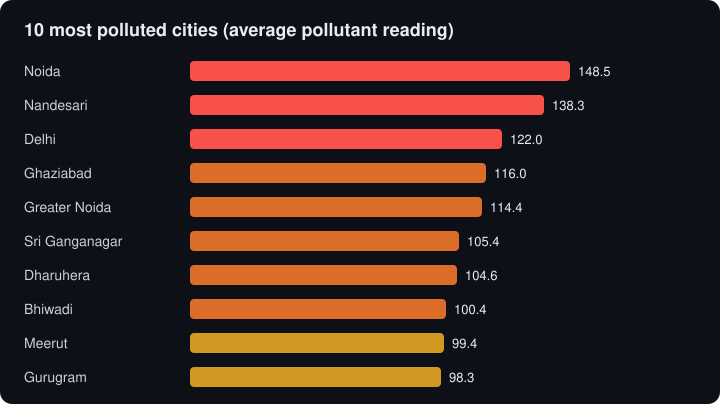
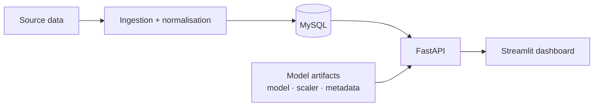

<div align="center">

# Pollution Analytics

**Air-quality analytics, AQI prediction and forecasting for Indian cities.**<br>
FastAPI backend, MySQL, ML models and a Streamlit dashboard.


[](https://pollution-analytics.onrender.com/health)

[**Open the dashboard**](https://deepbendale231-pollution-analytics-frontendstreamlit-app-yx00m4.streamlit.app/) · [**API health**](https://pollution-analytics.onrender.com/health) · [**Findings**](#what-the-data-shows) · [**Architecture**](#architecture) · [**Run it**](#run-it)

| Records | Cities | Stations | Average reading | Peak reading |
|:---:|:---:|:---:|:---:|:---:|
| **3,240** | **270** | **509** | **50.7** | **500** |

</div>

> Both services run on free tiers and sleep when idle. The first request after a pause can take up to a minute; use the API health link above to wake it first.

## What the data shows

Computed by the SQL in `SQL/air_quality.sql`; the raw outputs are in `outputs/SQL RESULTS/`.

<p align="center"></p>

- **The Delhi-NCR belt dominates.** Noida, Delhi, Ghaziabad, Greater Noida, Gurugram and Bhiwadi are all in the top 10.
- **486 of 3,240 readings (15.0%) exceed the safety threshold** used in the analysis.

## What it does

- City-level air-quality KPIs, rankings and pollutant breakdowns
- AQI prediction with lower and upper bounds
- Per-city forecasts with an uncertainty band
- Health-risk cards and activity advisories
- City comparison and deep-dive pages

## Architecture



<details>
<summary><b>API endpoints</b></summary>

Interactive docs are served at `/docs` on the API.

| Method | Route | Returns |
|---|---|---|
| GET | `/health` | service status |
| POST | `/predict` | predicted AQI with bounds |
| GET | `/forecast/{city}` | forecast for a city |
| GET | `/analytics/ranking` | cities ranked by pollution |
| GET | `/analytics/compare` | side-by-side city comparison |
| GET | `/analytics/city/{city}/stats` | city statistics |
| GET | `/analytics/city/{city}/pollutants` | pollutant-level breakdown |

</details>

<details>
<summary><b>Model</b></summary>

The committed model artifact (`models/metadata.json`) records:

| Metric | Value |
|---|---|
| R² | 0.952 |
| MAE | 6.40 |
| Training samples | 3,240 |
| Features | latitude, longitude, pollutant min, pollutant max |

Read the R² with care: the pollutant minimum and maximum bound the value being predicted, so the model is mostly interpolating between them. It is a useful estimator when a station reports a range, not a forecast of air quality from location alone. Forecasting uses Prophet, and SHAP is available for explanations (`ml/`).

</details>

<details>
<summary><b>Repository layout</b></summary>

| Folder | Contents |
|---|---|
| `backend/` | FastAPI app, routers, services |
| `frontend/` | Streamlit app, pages, API client |
| `ml/` | training, forecasting, explainability |
| `models/` | model, scaler and metadata |
| `scheduler/` | ingestion and orchestration jobs |
| `SQL/` | analysis queries |
| `outputs/` | SQL result tables |
| `tests/` | pytest suite |

</details>

## Run it

```bash
git clone https://github.com/deepbendale231/Pollution-Analytics.git
cd Pollution-Analytics
python3 -m venv .venv && source .venv/bin/activate
pip install -r requirements.txt
cp .env.example .env        # fill in your MySQL connection and API_BASE_URL

python -m uvicorn backend.app:app --port 8000
python -m streamlit run frontend/streamlit_app.py
```

Tests: `pytest -q`.

<details>
<summary><b>Deploying</b></summary>

- **Backend (Render):** start command `python -m uvicorn backend.app:app --host 0.0.0.0 --port $PORT`. Set `DB_HOST`, `DB_PORT`, `DB_USER`, `DB_PASSWORD` and `DB_NAME` in the Render environment settings, never in the repository.
- **Frontend (Streamlit Cloud):** set the secret `API_BASE_URL` to the Render URL.
- **Database:** use a managed MySQL instance and restore the data with `mysql ... < pollution_backup_nogtid.sql`, then check with `SELECT COUNT(*) FROM measurements;`.

</details>

## Limitations

- Data is a snapshot of 3,240 readings, not a live feed.
- The prediction model has four inputs and is not validated on cities it has not seen.
- Free-tier hosting means cold starts.
